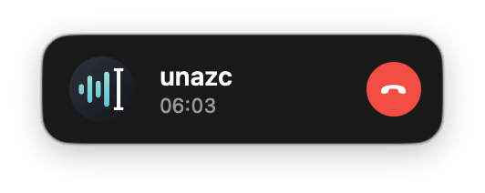

# Unazc

English | [日本語](README.ja.md)

Push-to-talk dictation for **Japanese** on Apple Silicon Macs. Hold Fn, speak, release: the text is pasted at the cursor. Recognition runs entirely on the Mac. It builds on openly published speech models and engines ([Acknowledgements](#acknowledgements)).

<p align="center"><br><sub>The optional call window, compact.</sub></p>

The speech models are Japanese, and the app's menus and settings are in Japanese. The full documentation is in [README.ja.md](README.ja.md).

## Features

- About 0.1–0.25 s from releasing Fn to the text appearing (measured on an M5). Speech is recognized pause by pause while you talk, so only the last stretch is left after release
- A live preview of the text near the cursor while you speak
- No filler removal and no LLM rewriting: you get what you said (written with an LLM as the paste target in mind)
- Optional 「、」 at pauses, line breaks on spoken 「改行」 / 「次の行」, and 「？」 on a rising ending
- A replacement dictionary for words the model keeps getting wrong (`wrong => right`, one per line)
- Pastes through the clipboard, then restores what was there once the target app has read it, marked so clipboard-history apps skip it
- Three engines, switchable from the menu: ReazonSpeech (default, fastest), ReazonSpeech Japanese–English, Kotoba-Whisper (slower, with punctuation)
- Extras, off by default: short backchannel replies (相槌, 「うん」) in your earphones at pauses, and a small "on a call" window. The name comes from うなずく (to nod)

It is not an input method: it pastes finished text, independent of any IME composition in progress.

## Requirements

- Apple Silicon Mac, macOS 14 or later
- Xcode Command Line Tools (Swift 6)
- About 2 GB of free space for the models

## Build

```sh
git clone https://github.com/mosle/unazc.git
cd unazc
sh scripts/fetch-deps.sh   # sherpa-onnx, whisper.cpp and the models
sh scripts/make-cert.sh    # self-signed signing identity "Unazc Dev" in the login keychain (once)
bash scripts/build-app.sh  # builds build/Unazc.app
open build/Unazc.app
```

A fixed signing identity keeps the microphone and Accessibility permissions across rebuilds. Without it the app is signed ad hoc and has to be re-granted after every build.

## First run

1. **Microphone**: allow it when asked
2. **Accessibility**: System Settings › Privacy & Security › Accessibility, turn on Unazc. Needed to detect Fn and to send ⌘V
3. If Fn alone opens the emoji picker or system dictation, set System Settings › Keyboard › "Press 🌐 key to" to "Do Nothing"

## Usage

| Action | Result |
|---|---|
| Hold Fn and speak | Records, with a live preview |
| Release Fn | Pastes the text at the cursor |
| Esc while recording | Cancels |
| Fn+V | Pastes the last text again |
| Fn+Z | Removes the last paste |
| Fn+D | Adds a dictionary entry, starting from the last text |
| Fn+R | Re-recognizes the last audio with the other engine and replaces the paste |

Fn can also be set to press-to-start / press-to-stop, and F13–F19 can record too, alongside Fn or instead of it, for a key on a macro pad or programmable keyboard (QMK, VIA, …) mapped to one of them (the chosen F keys no longer reach other apps). Everything else is in the menu bar icon and its settings window; see [README.ja.md](README.ja.md) for every option, the command-line tools and the login agent.

## Tests

```sh
swift test
```

## Acknowledgements

Unazc uses the models and software below. Thanks to everyone who publishes them.

| | License | Obtained by |
|---|---|---|
| [sherpa-onnx](https://github.com/k2-fsa/sherpa-onnx) | Apache-2.0 | `fetch-deps.sh`. The C API header `Sources/CSherpaOnnx/include/c-api.h` is included unmodified |
| [whisper.cpp](https://github.com/ggml-org/whisper.cpp) | MIT | `fetch-deps.sh` |
| [ReazonSpeech zipformer](https://k2-fsa.github.io/sherpa/onnx/pretrained_models/offline-transducer/zipformer-transducer-models.html) (sherpa-onnx build) | See the source | `fetch-deps.sh` |
| [Kotoba-Whisper v2.0](https://huggingface.co/kotoba-tech/kotoba-whisper-v2.0-ggml) | See the source | `fetch-deps.sh` |
| [Silero VAD](https://github.com/snakers4/silero-vad) | MIT | `fetch-deps.sh` |

The models are not in this repository; they are downloaded from their publishers at build time, under their own terms. The bundled backchannel sounds were generated with Gemini TTS and are not covered by the MIT license; no rights are claimed ([details](Resources/backchannel/README.md), in Japanese).

## License

MIT ([LICENSE](LICENSE))
